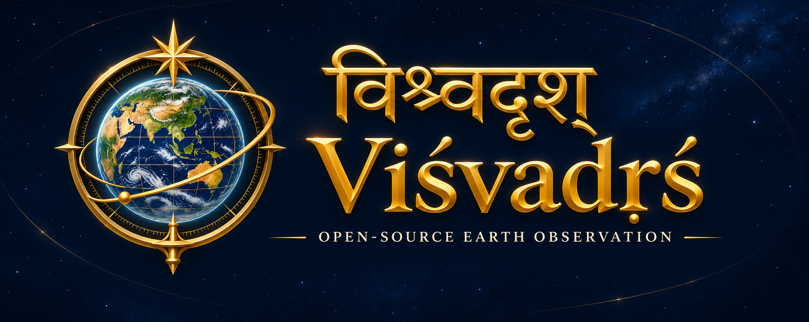

# Viśvadṛś | विश्वदृश्

दूराद् धरायाः स्पन्दनम् · *Earth's pulse from afar.*



Explore weather-satellite imagery, watch the clouds change and make your own
time-lapse videos. Viśvadṛś brings together current Himawari-9 views from JMA
and historical colour imagery from NICT. Images are retrieved on your device,
and videos are created in your browser.

**[Open Viśvadṛś](https://chipsncode.com/vishvadrish/)**

No project account or video-processing service is required. You can also run
the viewer locally from this repository.

## What you can explore

| View | Imagery |
| --- | --- |
| Full disc | JMA Himawari-9 True Color Reproduction, B13 infrared and B08 water vapour. |
| Australia | The same three JMA products in a fixed regional view covering mainland Australia and Tasmania. |
| History | NICT's archived, pre-rendered full-disc colour imagery at 550 × 550 pixels, in ten-minute steps. Requires the History extension. |

Colour imagery shows the daylight side of Earth; night-time areas can be dark.
True Color Reproduction is a processed composite, rather than an ordinary
camera photograph. Infrared shows cloud patterns by day and night, but the
image brightness is not a calibrated temperature measurement. Water vapour
shows upper-atmosphere patterns, rather than surface humidity.

**More satellite views are coming:** India is next, followed by Africa,
Europe and the Americas. These are planned additions, not currently available
views.

## Start exploring

1. Choose a **Region** and **Product**.
2. Choose **End** and **Hours** to select observations from JMA's available
   catalogue. **All available** selects everything up to the chosen end time.
3. Move the timeline slider, step through observations, or press **Play**.
   Playback buffers the selection first, with progress and a cancel button.
4. Open **Save** to download a frame, a sequence of images or a WebM video.

Use **fps** to change playback and video-export speed. Zoom, pan and fullscreen
help you inspect the imagery; zooming does not crop your exports. In fullscreen,
move the pointer or press a key to reveal the controls. The theme icon cycles
through System, Light and Dark.

For keyboard access, focus the timeline and use its arrow keys. In the image
view, use **+ / −** to zoom, **arrow keys** to pan and **0** to fit.

## Explore historical imagery

Choose **History**, set a **Date (UTC)** and **Start/End** times, then press
**Load**. Times must fall on ten-minute boundaries, such as 03:00 or 03:10;
the end time is included. UTC may differ from the time on your local clock.
Once loading finishes, use the same timeline,
playback and Save controls. Choose **Live JMA** to return to current imagery.

Historical imagery needs the **Viśvadṛś History** browser extension. If it is
missing, the viewer opens setup instructions. You can reopen them using
**Extension help**.

### Why the extra setup?

I'm sorry there's an extra step here. NICT's archive doesn't let an ordinary
web page download its pictures for video creation. The extension lets your
browser retrieve those pictures directly, so your images and videos don't need
to pass through a server I run. Video creation stays on your device too.

You only need the extension for History. Current JMA imagery works without it.
JMA and NICT still receive the requests for their pictures; this is not anonymous
access to those services.

If you're using someone else's computer, ask its owner before installing the
extension. If you're unsure about a step, ask someone to help.

### Chrome

1. Open **History** in the viewer and download the Chrome extension from the
   setup instructions.
2. Open the ZIP file to extract it. Keep the extracted folder somewhere you
   won't accidentally delete it.
3. Type `chrome://extensions` into Chrome's address bar and press Enter.
4. Turn on **Developer mode**.
5. Choose **Load unpacked**, then select the extracted folder containing
   `manifest.json`.
6. Allow access to NICT if Chrome asks. Return to Viśvadṛś and reload the page.

Keep that folder while you use the extension. To update it, replace its contents
with the new download and press **Reload** on the extension's entry in Chrome.

### Firefox and Zen

1. Open **History** in the viewer and download the signed Firefox extension
   from the setup instructions. Use this package for Zen too.
2. Open your browser's **Add-ons and themes** page. In Firefox, you can type
   `about:addons` into the address bar.
3. Open the tools menu, shown as a cog, and choose **Install Add-on From File**.
4. Select the downloaded `.xpi` file, approve installation and allow access to
   NICT when prompted.
5. Return to Viśvadṛś and reload the page.

Use the signed package for normal installation. The History extension does not
support Safari or mobile browsers. See [historical imagery](docs/HISTORICAL_IMPORT.md)
for more detail.

## Save images and video

| Output | Contents |
| --- | --- |
| PNG frame | The current observation with source credit. |
| ZIP image sequence | Selected PNG frames, attribution and a JSON provenance manifest. |
| WebM video | Selected observations encoded locally, with a preview and downloadable manifest. |

Choose a 550 or 1100 px image width, video quality and playback rate. For gaps,
choose **Skip** or **Hold previous**. Timestamp text is optional; required source
credit is always included in an additional 56 px strip. Output height follows
the selected region's aspect ratio. Enlarging a historical image does not add
detail beyond its 550 × 550 source.

WebM uses VP9 or VP8 according to browser support. MP4 is not available. If your
browser cannot encode video, use the image sequence instead. Cancellation stops
the job without offering a partial download.

## Coverage, timing and limits

- **JMA's live catalogue is not a long-term archive.** Hours selects from its
  available observations. Use History for an earlier date.
- **Times need care.** JMA catalogue labels mark scan end; filename slots mark
  scan start, ten minutes earlier. JMA reuses image URLs, and printed image
  timestamps are not independently read. Historical NICT times are provider
  URL slots; their exact scan-start/end meaning is unverified.
- **Archive coverage can have gaps.** Missing NICT requests are counted and
  skipped. Other loading failures leave the previous sequence available.
  The archive's earliest date and continuous coverage are not guaranteed;
  valid image placeholders are not independently detected.
- **History selections stay within one UTC date.** Choose up to 144 ten-minute
  slots. Images are limited to 5 MB each and 50 MB per sequence, so a whole day
  may not fit. Historical imagery is colour only, for non-commercial use.
- **Exports and playback are bounded.** Export output is capped at 50 MB and
  144 output frames, including held gaps. Decoded playback has a separate
  256 MB memory limit. Shorten the selection or reduce output size if needed.
- **Regional geometry is provider-supplied.** Australia's raster covers
  110–155°E and 10–45°S. Exact map projection and pixel conventions remain
  unverified; no coordinate overlays or reprojection are applied.

Live images can be reused across refreshes in the same tab session through a
bounded browser cache. Historical images stay in memory until replaced or the
page closes or reloads. Neither is a personal archive of downloaded observations.

Chromium has automated playback and export coverage. Safari and Zen have passed
baseline live JMA export checks; historical acquisition and encoding have also
been exercised through the Firefox package in Zen. Physical phones and tablets
have not been tested. See [browser support](docs/browser-support.md) for the
specific checks and limitations.

## Run locally

Install **Node.js 20 or newer**, then run:

```sh
git clone https://github.com/Marzogh/vishvadrish.git
cd vishvadrish
npm ci
npm run dev
```

Open the local URL printed in the terminal. Keep it running while using the
viewer; press **Ctrl+C** to stop it. Internet access is needed for provider
imagery. History uses the extension here too; no local acquisition server or
manual image import is needed.

## Static hosting and embedding

```sh
npm run build
```

The build prints its progress and writes a static site to `dist/`. Publish that
directory's contents. Fonts and runtime dependencies are bundled locally; no
observational imagery or generated videos are included. The build does not
publish the site or produce a Mozilla-signed extension.

The **GitHub Pages** workflow runs tests and builds `dist/` for pushes and pull
requests to `main`. A successful push to `main` automatically publishes the
built site. Pull requests only test and build; they do not publish. You can also
run the workflow manually from `main` to rebuild and publish. Set the
repository's Pages source to **GitHub Actions**. Only `dist/` is uploaded for
publication. The public viewer address is `https://chipsncode.com/vishvadrish/`.

Relative asset paths support hosting under a project subdirectory. Region and
product choices are included in the URL, for example
`?region=australia&product=b13`. Add `&embed=1` for a compact article view with
an **Open viewer** link. Use the standalone viewer for History setup. The History
extension recognises the project's GitHub Pages address and local previews;
hosting the viewer elsewhere requires corresponding extension configuration.

See [static hosting and embedding](docs/static-hosting.md) for iframe markup,
fullscreen permissions and social-preview configuration, and
[historical imagery](docs/HISTORICAL_IMPORT.md) for extension packaging.

## Development

Run the core tests:

```sh
npm test
```

For Chromium browser tests, install the dependencies and browser, then choose
an output directory outside the checkout:

```sh
npm ci
npx playwright install chromium
export VISHVADRISH_TEST_OUTPUT="$(mktemp -d)"
printf 'Browser test output: %s\n' "$VISHVADRISH_TEST_OUTPUT"
npm run test:browser
```

The browser-test command builds the static site first and prints individual
results. Screenshots and failure traces go to `VISHVADRISH_TEST_OUTPUT`.
Default browser fixtures do not require live imagery. Set `JMA_LIVE=1` to include
the opt-in live JMA checks. Set `VISHVADRISH_TEST_PORT` to change the default
local test port, 4173.

Browser modules expose provider discovery and sequence selection for
programmatic use. A self-hosted HTTP API, general local-sequence import and
additional providers remain future work. See [architecture](docs/architecture.md),
[source support](docs/sources.md) and [third-party components](docs/third-party.md).

## Licence and credit

Application code is [MIT-licensed](LICENSE). Provider imagery has separate terms
and attribution requirements; the code licence does not grant imagery rights.
Historical NICT imagery is supported for non-commercial use.

JMA is credited for its imagery. True Color Reproduction also retains
NOAA/NESDIS and CSU/CIRA credit. Historical exports retain NICT, JMA and CEReS
credit. Fuller acknowledgements accompany source details, manifests and image
packages. See [source support](docs/sources.md).

A [Chips’nCode](https://chipsncode.com/) project.
